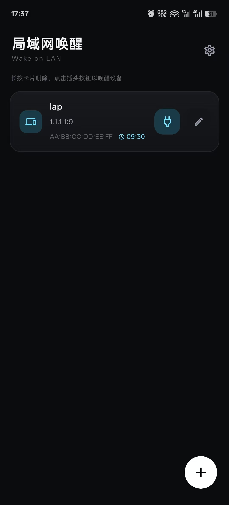
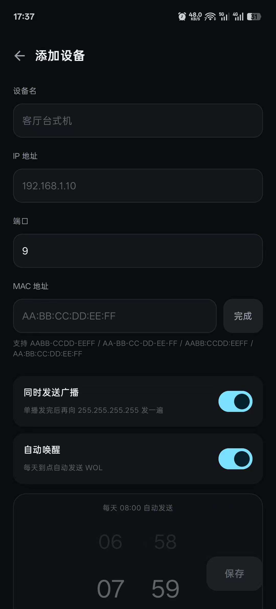
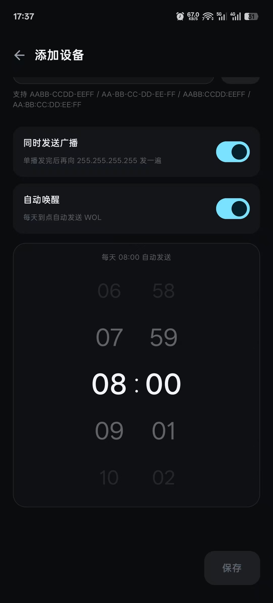
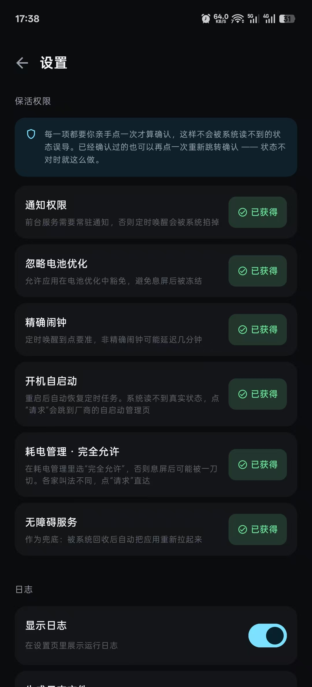
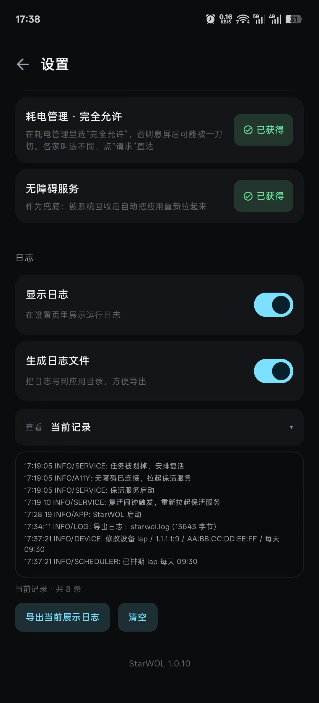
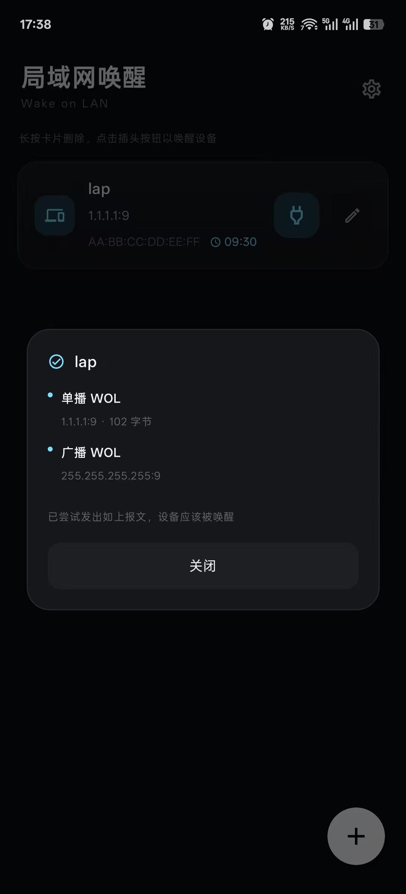

# StarWOL

局域网唤醒（Wake-on-LAN）的安卓客户端。深色主题，原生 Kotlin + Jetpack Compose。

## 展示

| 主页                               | 添加设备页                                   | 添加设备页2                          |
| ---------------------------------- | -------------------------------------------- | ------------------------------------ |
|        |                    |  |
|                                    |                                              |                                      |
| **设置页**                         | **设置页2**                                  | **唤醒页**                           |
|  |  |      |


## 如何使用

0. 进入release下载安装包，并且确认你已经在电脑上配置好了wake on lan
1. 右下角添加设备
2. 填写IP地址和MAC
   - 如何找到windows上的IP和mac
     - 打开电脑设置-->网络-->找到你的网卡-->属性-->最底下有IPV4地址和物理地址(MAC)
3. 填写好后可以选择额外广播，向手机同一网络内所有开启了wake on lan的设备尝试唤醒
4. 如果有指定时间唤醒需要授权保活服务
   - 进入APP右上角设置-->授权全部权限
   - 手动确认以下内容：
     1. 长按桌面图标-->应用详细-->开启通知
     2. 长按桌面图标-->应用详细-->耗电管理-->完全允许
     3. 无障碍，代码已经全部开源，无恶意操作
     4. 手机设置搜索自启动，并授予StarWOL自启动权限
5. 如有问题，请在APP右上角设置截图日志或导出日志发issue

## 功能

- 设备卡片：右侧两个按钮分别唤醒和编辑，长按删除
- MAC 支持 `AABB-CCDD-EEFF` / `AA-BB-CC-DD-EE-FF` / `AABB:CCDD:EEFF` / `AA:BB:CC:DD:EE:FF`，填完点「完成」归一化
- 发送单播 magic packet 到 `IP:端口`，可选再向 `255.255.255.255` 广播一遍
- 每天定时自动唤醒，滚轮选时间（24h 循环）
- 保活：设置页逐项申请通知、电池优化豁免、精确闹钟、自启动、耗电管理、无障碍
- 运行日志：设置页实时查看、导出分享、落盘到应用私有目录，显示与落盘各有开关（默认开）
- 二级页支持系统返回键和返回手势

## 日志

- 文件保留 5 份：`starwol.log` 是正在写的，`starwol.1.log` ~ `starwol.4.log` 是历史。
  当前文件写满 512KB 就整体后移一位，最老的一份删掉
- 设置页可以切换查看任意一份（当前记录 / 前1个_时间 / … / 前4个_时间），
  切换只影响显示，当前日志照常记录
- 「导出当前展示日志」导出的就是下拉里选中的那一份，走 FileProvider + 系统分享
- 内存里另外留最近 300 条给实时视图
- 设置页两个开关：显示日志、写入日志文件，默认都开
- 埋点覆盖：启动、服务、WOL 发送/广播、定时排期、设备增删改、设置变更

## 本地构建

需要 JDK 17 + Android SDK（platform 34、build-tools 34.0.0）。

```bash
# local.properties 里写 sdk.dir=<你的 Android SDK 路径>
./gradlew assembleDebug
```

产物：`app/build/outputs/apk/debug/app-debug.apk`

国内网络可以在 `gradle.properties` 或环境变量里开镜像：

```bash
export USE_CN_MIRROR=true
```

## GitHub Actions 打包

推送到 `main` 或有 tag 时自动跑 `.github/workflows/build.yml`，产出：

- `StarWOL-debug`：可直接安装的 debug 包
- `StarWOL-release`：release 包

release 默认用工程内 `.keystore/starwol.jks`（密码都是 `starwol`）。要换成自己的签名，在仓库 Secrets 里配：

| Secret | 说明 |
| --- | --- |
| `KEYSTORE_BASE64` | keystore 文件的 base64 |
| `KEYSTORE_PASSWORD` | store 密码 |
| `KEY_ALIAS` | 别名 |
| `KEY_PASSWORD` | key 密码 |

没配 `KEYSTORE_BASE64` 时工作流会现场生成一个临时 keystore，保证 release 能构建出来（但那不是稳定签名，只适合自测）。

## 保活说明

WOL 定时任务要活得久，单靠一个 App 是打不过国产 ROM 的。现在做的是：

1. 精确闹钟（`setExactAndAllowWhileIdle`）——定时唤醒的骨架
2. 前台服务常驻 + 开机 / 解锁广播重新排期
3. 前台服务被划掉或回收时，用复活闹钟（AlarmManager）把它拉回来
4. 设置页逐项申请：通知、电池优化豁免、精确闹钟、自启动、耗电管理、无障碍兜底

系统读不到「自启动」「耗电管理」的真实状态，所以这里不猜 —— 一律以你亲手点过的为准：进入设置页时全部显示未获得，每点一次就确认一项。已经确认的还能再点，如果发现某项其实没生效，再点一次重新跳转就行。

## 目录

```
app/src/main/java/com/starchen/wol/
├── MainActivity.kt          应用入口 + 页面切换 + 发送结果弹窗
├── data/                    设备模型 + DataStore 持久化
├── wol/                     MAC 解析、magic packet 发送
├── service/                 前台服务、定时调度、开机广播、保活
├── ui/                      主页、编辑页、设置页、滚轮组件
└── util/                    日志存储
```

## 协议

MIT协议
